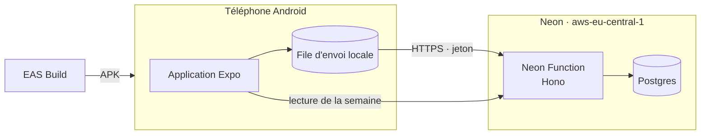

# Badge Mie

Le code source de Badge Mie, une application Android pour pointer mes heures d'arrivée et de
départ, y compris là où le réseau ne passe pas.

C'est un petit projet personnel : un seul utilisateur, une installation par APK, ni store ni
compte, et le minimum de pièces mobiles.

## Ce que fait l'application

- **La semaine en cours sur un écran**, du lundi au dimanche : pour chaque jour, l'arrivée, le
  départ et la durée ; le total d'heures en haut, et deux flèches pour changer de semaine. Le
  samedi, le dimanche et les jours fériés sont grisés, mais on peut y pointer ; un férié non
  pointé du lundi au vendredi compte 8 h 30.
- **Pointer d'un geste** : un seul bouton, à maintenir environ une demi-seconde, qui pointe l'arrivée
  puis le départ. « Annuler » reste visible cinq secondes.
- **Corriger à la main** n'importe quelle heure, avec le sélecteur natif d'Android.
- **Hors ligne d'abord** : l'heure enregistrée est celle du geste, gardée sur le téléphone puis
  envoyée dès que le réseau revient. Un indicateur dit si tout est « Enregistré » ou combien de
  pointages sont « En attente d'envoi ».
- **Pas de compte** : un jeton, saisi une fois au premier lancement et gardé dans le stockage
  sécurisé du téléphone.
- **Un widget d'écran d'accueil** de 2×2 cases : en haut l'arrivée et le départ du jour, et une
  pastille qui dit si tout est envoyé ; en dessous un bouton « Badger » qui pointe en deux
  touchers. Le premier l'arme : il s'inverse en « Confirmer », et un compte à rebours montre les
  3 s qui restent ; le second pointe, par le même chemin que l'application. Toucher une heure
  ouvre l'application.

## Où en est le projet

- **Fait** : la [version 1.0.0](https://github.com/plecart/badge-mie/releases/tag/v1.0.0), du
  lundi au vendredi : l'API, l'application, le pointage hors ligne et l'APK ; puis la semaine
  sur sept jours avec les jours fériés, et le widget Android.
- **À venir** : les congés posés dans un calendrier et un rappel quand un pointage manque.

Le découpage vit dans les [issues](https://github.com/plecart/badge-mie/issues) et les
[milestones](https://github.com/plecart/badge-mie/milestones).

## Architecture

- **L'application ne parle jamais à Postgres** : une Neon Function, à côté de la base, expose
  deux routes, `GET /semaines/:lundi` et `PUT /jours/:date`.
- **Local d'abord, envoi ensuite** : chaque `PUT` porte l'état complet d'un jour et le dernier
  écrit l'emporte, si bien que rejouer un envoi n'abîme rien.
- **Un jeton plutôt qu'un compte** : la Function le compare en temps constant ; il n'est jamais
  compilé dans l'APK.
- **Un calendrier pur** : le paquet `week/`, sans réseau ni horloge, est partagé par
  l'application et l'API.
- **L'APK se construit dans le cloud, à la release seulement** : EAS Build le produit ; en
  développement, l'app et son widget tournent sur l'émulateur d'Android Studio, dans un build de
  développement construit sur le poste (`npm run android -w app`, avec `JAVA_HOME` sur un JDK 17
  ou plus ; sous Windows, un plugin raccourcit les chemins du C++ généré, et le build aboutit
  depuis une racine de 5 comme de 60 caractères, mesuré dans la ligne `run local` de
  `.claude/pipeline.config.md`).

## Stack

| Couche | Technologies |
|---|---|
| Application | Expo, React Native, React, TypeScript |
| API | Neon Functions, Hono, node-postgres |
| Données | PostgreSQL sur Neon |
| Build | EAS Build (APK) |
| Outillage | npm workspaces, Vitest, ESLint, Prettier, GitHub Actions, Dependabot |

## Qualité

- **Tests** : Vitest sur toute la logique (calendrier de semaine, pointage du jour, file d'envoi,
  gestionnaire du widget, API) ; les écrans et la mise en page du widget, eux, se valident à
  l'œil.
- **CI à chaque PR** : audit des dépendances, lint, format, typecheck et tests.

## Les décisions

Les choix structurants sont dans les ADR — le contexte, les options écartées et pourquoi :
l'[ADR-0001](docs/adr/0001-stack-et-architecture.md) pour la stack et l'architecture,
l'[ADR-0002](docs/adr/0002-widget-android.md) pour le widget Android. Le raisonnement du PRD et
des amendements est archivé dans [`docs/archive/`](docs/archive/).

## Une pipeline de développement par agents IA

Ce projet est développé avec une pipeline pilotée par des agents
([Claude Code](https://claude.com/claude-code)) : des issues triées par une machine à états, un
cycle de PR en TDD, des relectures à contexte vierge, des rôles d'agents choisis selon ce qu'ils
ont le droit de décider, et un humain qui garde les décisions de produit et le merge.

- [`CLAUDE.md`](CLAUDE.md) et [`CONTRIBUTING.md`](CONTRIBUTING.md) décrivent le fonctionnement ;
- [`.claude/skills/`](.claude/skills/) contient les skills de la pipeline ;
- [`.claude/agents/`](.claude/agents/) définit les rôles ;
- [`.claude/rules/`](.claude/rules/) porte les règles toujours actives.

L'historique des issues et des PR montre la pipeline au travail.

## Licence

Code, contenu et visuels : tous droits réservés. Le dépôt est public pour être lu, pas pour être
réutilisé.

Les skills, icônes et polices de tiers copiés dans `.claude/` restent sous leur propre licence :
[`THIRD_PARTY_NOTICES.md`](THIRD_PARTY_NOTICES.md).
